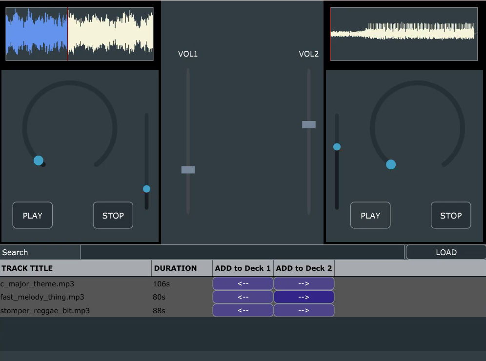
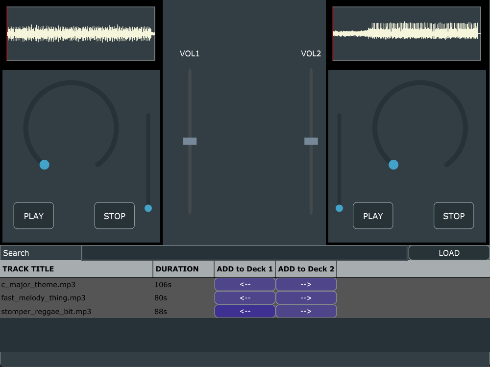
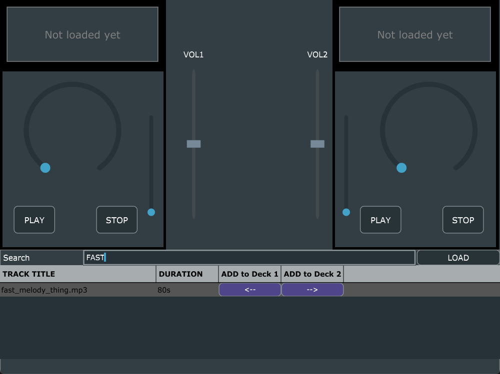

# DJ Mixing App

A two-deck DJ mixing application written in **C++** with the **JUCE** framework. Load tracks into a library, send them to either deck, scrub through the waveforms, change playback speed and blend the decks with the volume faders.

Built on the course's starter framework (OtoDecks). I designed and implemented the track library with search, the mixer with custom-drawn faders, and the deck layout with the clickable waveform and rotary position control.

<table>
  <tr>
    <td></td>
    <td></td>
  </tr>
</table>

## Features

- **Two decks:** each with PLAY and STOP, a waveform display with a moving playhead, a rotary position control and a vertical speed slider (0.5x to 2x). Click the waveform to jump to that point in the track.
- **Mixer:** two volume faders with a custom look, drawn with notch marks.
- **Track library:** add tracks with **LOAD** (several at once) or by dropping files onto it. It shows each track's length, ignores files that are not audio, and has a live, case-insensitive **search**. The `<--` and `-->` buttons send a track to deck 1 or deck 2.
- **Drop to load:** drop an audio file straight onto a deck to load it with its waveform.
- **Formats:** WAV, AIFF, FLAC, OGG Vorbis and MP3.

## Code structure

| Class | Role |
|---|---|
| `DJAudioPlayer` | Audio source for one deck: loading, play/stop, position, gain and speed (resampling) |
| `DeckGUI` | A deck's controls and layout; sends user input to its player |
| `WaveformDisplay` | Draws the track waveform and the playhead |
| `mixerComponent` | The two volume faders |
| `CustomLookAndFeel` | The notched fader style |
| `PlaylistComponent` | The track library table, search and load buttons |
| `MainComponent` | Wires the decks, mixer and library together and mixes the two players into the audio output |

## Build

Requires [JUCE 7](https://juce.com/) and a C++17 compiler.

1. Open `OtoDecks.jucer` in the Projucer and set the path to your JUCE modules (File > Global Paths).
2. Save the project to generate the Visual Studio, Xcode or Linux Makefile build for your platform.
3. Open the generated project in `Builds/` and build the `OtoDecks` app.

Built and run with JUCE 7.0.9 and Visual Studio 2019 on Windows.

## Tech Stack

C++ · JUCE (audio, GUI)

## Author

Ziad Elhussein
